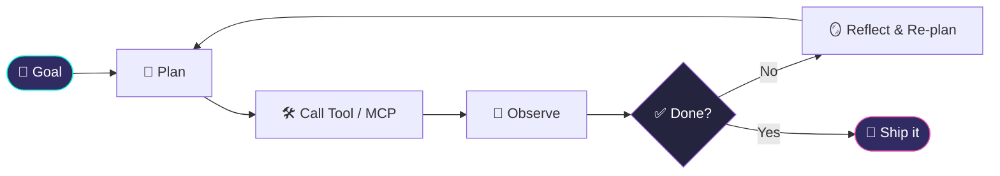

<!-- ═══════════════ HEADER ═══════════════ -->
<p align="center">
  
</p>

<p align="center">
  
</p>

<p align="center">
  
  
  
  
</p>

---

## 🧠 `agent.profile`

```python
class Prajwal(Agent):
    """B.Tech Computer Engineering @ PCCOE, Pune 🇮🇳"""

    role        = "Full-Stack Dev → Agentic AI Engineer"
    brain       = ["React", "Node.js", "MongoDB", "Python"]
    learning    = ["LangGraph", "MCP", "Multi-Agent Systems", "Next.js"]
    mission     = "Build AI agents that plan, use tools & ship real products"
    open_to     = ["open-source", "hackathons", "agent-based side projects"]
    ask_me_about = ["React", "Node.js", "MongoDB", "FastAPI", "LangChain"]

    def run(self):
        while self.curious:
            self.learn() ; self.build() ; self.ship() ; self.repeat()
```

---

## 🔄 My Agent Loop (how I work)



---

## 🧰 Agent Toolkit

### 🤖 Agentic AI Stack
<p>
  
  
  
  
  
  
  
  
  
  
</p>

### 🧬 Memory & Vector Stores
<p>
  
  
  
  
  
  
</p>

### 🎨 Interface Layer (Frontend)
<p>
  
  
  
  
  
  
  
</p>

### ⚙️ Backend & Languages
<p>
  
  
  
  
</p>

### 🚢 DevOps & Tools
<p>
  
  
  
  
  
</p>

---

## 🗂️ Tool Registry

```json
{
  "tools": [
    { "name": "web_dev",       "stack": "React · Next.js · Node · Express",   "status": "🟢 active"   },
    { "name": "agent_builder", "stack": "LangChain · LangGraph · FastAPI",     "status": "🟡 leveling up" },
    { "name": "mcp_servers",   "stack": "MCP · tool calling · function schemas","status": "🟡 exploring" },
    { "name": "memory",        "stack": "RAG · ChromaDB · MongoDB",            "status": "🟡 building" }
  ]
}
```

---


## 🤖 Featured Agents (Projects)

<!-- 👇 Replace these with your real projects! -->
| Agent | What it does | Stack |
|:--|:--|:--|
| 🕵️ **ResearchBot** | Searches the web, reads sources, writes summaries | `LangGraph` `FastAPI` `Tavily` |
| 📚 **DocuMind** | Chat with your PDFs using RAG | `LangChain` `ChromaDB` `React` |
| 🔌 **MCP-Hub** | Custom MCP server exposing tools to LLM clients | `MCP` `Python` `Node.js` |
| 🌐 **Portfolio v2** | Personal site with an AI assistant | `Next.js` `Tailwind` |

> 💡 *Pin your best 4–6 repos on your profile and link them above.*

---

## 📊 Telemetry (GitHub Stats)

<p align="center">
  
  
</p>

<p align="center">
  
</p>

<p align="center">
  
</p>

---


## 🤝 Establish Connection

<p align="center">
  <a href="https://github.com/Prjhage"></a>
  <a href="https://www.linkedin.com/in/prajwal-hage-58738a303/"></a>
</p>

<p align="center">
  <i>"The best way to predict the future is to build an agent that does it for you."</i> 🤖
</p>

<p align="center">
  
</p>
